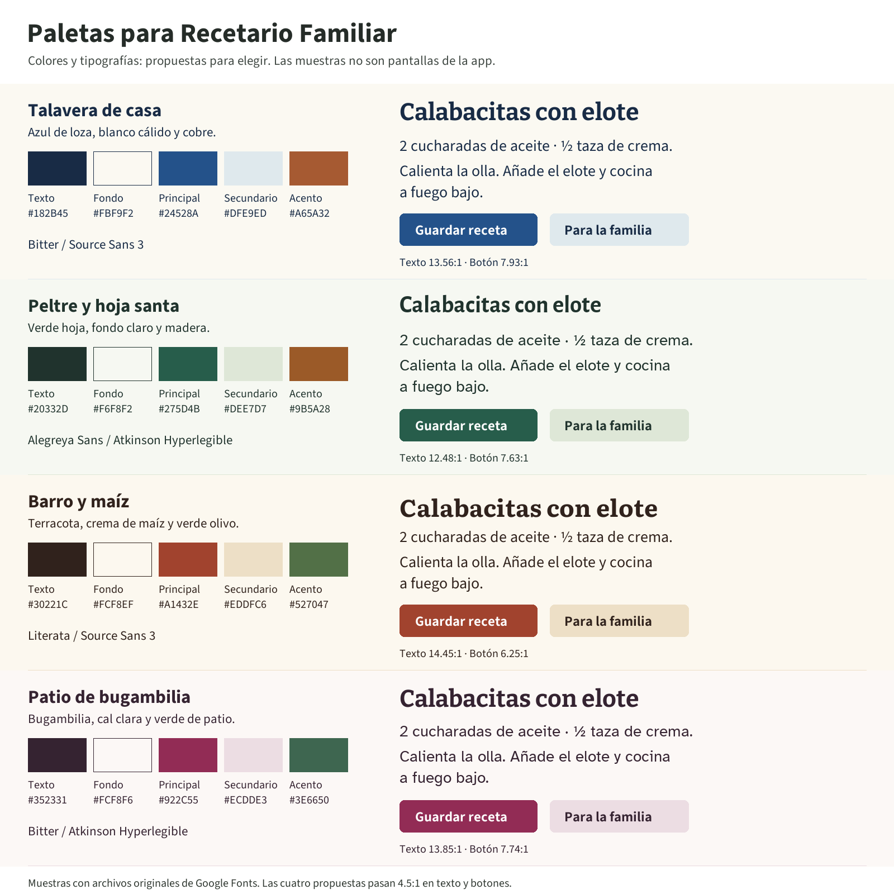

# Family Recipes: palette and typography exploration

Status: **Patio de bugambilia selected by the user on November 12, 2026.** Other options are retained as exploration history.

This document records the approved palette/type direction and its exploration. The choice has not yet been applied to application styles. `DESIGN.md` should describe the eventual implemented system after native visual review.

## Confirmed brief

- Primarily older women and adult relatives in Mexican families.
- A Mexican identity that feels personal, familiar, and appropriate for family recipes.
- Spanish first, with English support. Preserve the existing native behavior, ownership, sharing and audited confirmations.
- Use Realtime Colors for palette and heading/body font comparisons. The user explicitly made this a standing preference for **all future design work**; saved in `/Users/aledev/.codex/AGENTS.md`. The Mexican identity and audience apply to this project only.
- The user selected **Patio de bugambilia**, including its Bitter / Atkinson Hyperlegible pairing. The user’s original Realtime Colors URL is the tool reference, not approval of its purple/Inter defaults.

## Incumbent findings

`src/components/theme.ts` uses a periwinkle background (`#EEF1FF`), lavender-white surfaces (`#FAF9FF`), navy text (`#172554`) and blue primary (`#3159C6`). Components do not define a custom `fontFamily`. Shared family styles use 800-weight titles and repeated 18-radius bordered cards; buttons and inputs use 12-radius boxes. The resulting repeated containers and heavy headings contribute to a generic software-template appearance.

The redesign should give recipe text and family attribution a clear hierarchy, simplify repeated containers, and place color deliberately. Cultural character can come from everyday domestic color references and readable typography. Typography choices below are not claims that these fonts were designed in Mexico.

## Comparison

The five roles are **text, background, primary, secondary, accent**, in the same order as each Realtime Colors URL. Use primary for key actions/selection, secondary for contextual surfaces, and accent sparingly for supporting emphasis. Error and warning roles need their own distinguishable semantic treatment during implementation.

The comparison uses original Google Fonts files, not generated lettering. The Spanish recipe text is an illustrative specimen. These are palette/type samples, not app screenshots.

## Talavera de casa

[Open this exact palette and font pair in Realtime Colors](https://www.realtimecolors.com/?colors=182b45-fbf9f2-24528a-dfe9ed-a65a32&fonts=Bitter-Source+Sans+3)

Blue glazed pottery, warm white and copper.

**Heading:** Bitter. **Reading content:** Source Sans 3. Bitter gives recipe headings a sturdy printed voice; Source Sans 3 keeps reading content straightforward.

| Role | Color |
| --- | --- |
| Text | `#182B45` |
| Background | `#FBF9F2` |
| Primary | `#24528A` |
| Secondary | `#DFE9ED` |
| Accent | `#A65A32` |

**Tradeoff:** Can become cold if blue spreads across every surface. Keep content warm and attribution prominent.

## Peltre y hoja santa

[Open this exact palette and font pair in Realtime Colors](https://www.realtimecolors.com/?colors=20332d-f6f8f2-275d4b-dee7d7-9b5a28&fonts=Alegreya+Sans-Atkinson+Hyperlegible)

Light enamelware, cooking leaves and wooden utensils.

**Heading:** Alegreya Sans. **Reading content:** Atkinson Hyperlegible. Alegreya Sans gives headings a humanist voice; Atkinson Hyperlegible is the reading-content candidate.

| Role | Color |
| --- | --- |
| Text | `#20332D` |
| Background | `#F6F8F2` |
| Primary | `#275D4B` |
| Secondary | `#DEE7D7` |
| Accent | `#9B5A28` |

**Tradeoff:** Most restrained option; its Mexican character must also come through the language, recipes and photographs.

## Barro y maíz

[Open this exact palette and font pair in Realtime Colors](https://www.realtimecolors.com/?colors=30221c-fcf8ef-a1432e-eddfc6-527047&fonts=Literata-Source+Sans+3)

Earthenware, maize-colored surfaces and olive green.

**Heading:** Literata. **Reading content:** Source Sans 3. Literata gives the recipe title a book-like voice; Source Sans 3 handles the reading content.

| Role | Color |
| --- | --- |
| Text | `#30221C` |
| Background | `#FCF8EF` |
| Primary | `#A1432E` |
| Secondary | `#EDDFC6` |
| Accent | `#527047` |

**Tradeoff:** Cream plus terracotta is a familiar recipe-app trope. It needs disciplined native presentation and real family content to avoid becoming another generic template.

## Patio de bugambilia

[Open this exact palette and font pair in Realtime Colors](https://www.realtimecolors.com/?colors=352331-fcf8f6-922c55-ecdde3-3e6650&fonts=Bitter-Atkinson+Hyperlegible)

A bougainvillea patio, pale walls and deep green foliage.

**Heading:** Bitter. **Reading content:** Atkinson Hyperlegible. Bitter carries sturdy headings; Atkinson Hyperlegible carries the reading specimen.

| Role | Color |
| --- | --- |
| Text | `#352331` |
| Background | `#FCF8F6` |
| Primary | `#922C55` |
| Secondary | `#ECDDE3` |
| Accent | `#3E6650` |

**Tradeoff:** Bolder than the green and blue options. Choose it for its character, not because the primary audience is women.

## Selected direction

**Patio de bugambilia** is the user’s approved direction. Use deep bugambilia `#922C55` for primary actions and selection, pale `#FCF8F6` for the reading background, dark plum `#352331` for text, soft `#ECDDE3` for secondary surfaces, and foliage green `#3E6650` as the supporting accent. Headings use **Bitter**; recipe reading content uses **Atkinson Hyperlegible**. Preserve comfortable reading sizes, system text scaling and native control conventions.

The earlier Peltre recommendation was not selected. The three alternatives are historical references, not competing implementation defaults.

Atkinson Hyperlegible is specifically designed for distinguishable letterforms and numerals for people with low vision: see [Braille Institute’s font explanation](https://www.brailleinstitute.org/freefont/). Legibility still requires adequate size, spacing, contrast and real-user testing.

## Contrast checks

Calculated with sRGB relative luminance, `(Llighter + 0.05) / (Ldarker + 0.05)`, rounded only for display. These combinations pass 4.5:1. This is a palette check, not a claim that an entire interface is accessible.

| Proposal | Text/background | White/primary button | Text/secondary | Accent/background |
| --- | ---: | ---: | ---: | ---: |
| Talavera de casa | 13.56:1 | 7.93:1 | 11.57:1 | 4.83:1 |
| Peltre y hoja santa | 12.48:1 | 7.63:1 | 10.50:1 | 5.05:1 |
| Barro y maíz | 14.45:1 | 6.25:1 | 11.65:1 | 5.26:1 |
| Patio de bugambilia | 13.85:1 | 7.74:1 | 11.15:1 | 6.18:1 |

Do not put white text on secondary or accent colors without checking that exact combination. Native outline/focus/error/disabled/dark-mode tokens remain to be designed and verified after selection.

## Typography and native follow-through

- Proposed starting point for recipe reading: 18–20 sp at the normal Android setting, with user scaling preserved, and generous line spacing. Verify on an actual narrow phone and with increased system text size; do not lock text to fixed pixels.
- Reserve display character for recipe titles and a few meaningful headings. Keep ingredient quantities, labels and actions clear; avoid thin weights, decorative handwriting and all-caps body copy.
- Stress samples: `ñ á é í ó ú ü ¿Qué lleva?`, `½ taza`, `1¼ cucharaditas`, `100 ml`, and long family names. Verify glyph coverage and fallback in the eventual native build.
- Android controls follow Material conventions; iOS controls and UI labels retain platform conventions. These font pairings are identity/reading-content explorations, not a mandate to replace every system control font.
- Minimum interactive targets: Android 48 dp, iOS 44 pt. Keep visible text labels and clear selected states.
- For the eventual implementation: bundle the chosen licensed font assets locally, map actual font files/weights explicitly, preserve text scaling, and verify light/dark/large-text behavior. Do not introduce a font dependency just for this exploration.

## Realtime Colors verification

Opened each of the four exact URLs in the browser. Confirmed rendered-page computed heading/body font-family names and body text/background colors. Inspected the visible palettes and saved comparison captures. Realtime Colors is a web preview; it does not replace native Android/iOS rendering checks.

Tool reference: [Realtime Colors font setup](https://www.realtimecolors.com/docs/font-setup). Font metadata and OFL license information: [Google Fonts repository](https://github.com/google/fonts/tree/main/ofl). `specimen-font-sources.json` records the original specimen font files and SHA-256 values. No application font files or dependencies were added.

## Decision log

November 12, 2026 — the user chose: “I'm gonna go with patio de bugambilia”. Record `bugambilia` as `selectedId` in `palette-options.json`. No change to its proposed colors or font pair was requested. Carry the final implemented roles into `DESIGN.md` after native visual review.

The next design step is to apply the chosen pair to representative recipe list, detail and editor screens, while retaining all existing workflows. This exploration does not authorize new product features, server changes, a new APK, or merging PR #22.
